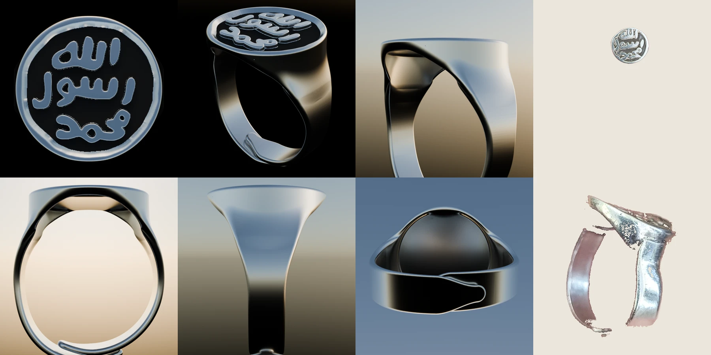
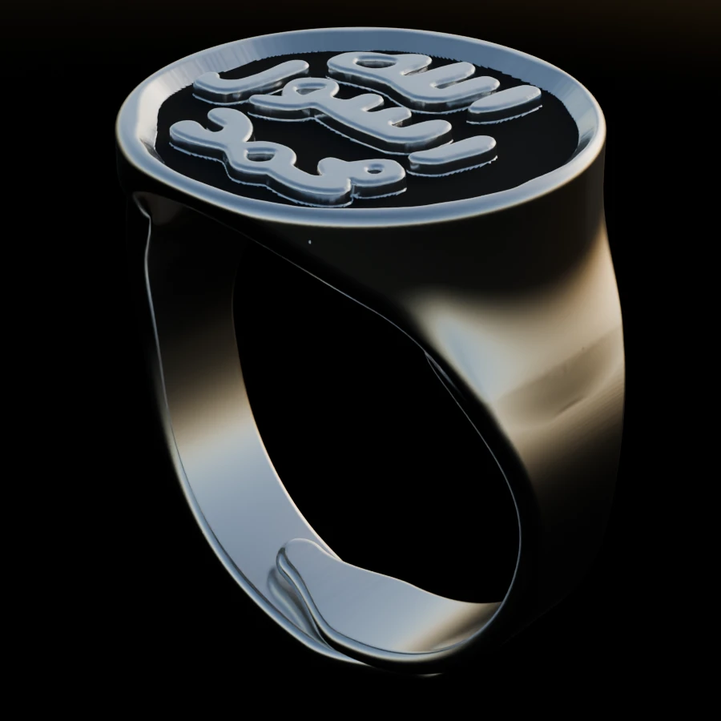
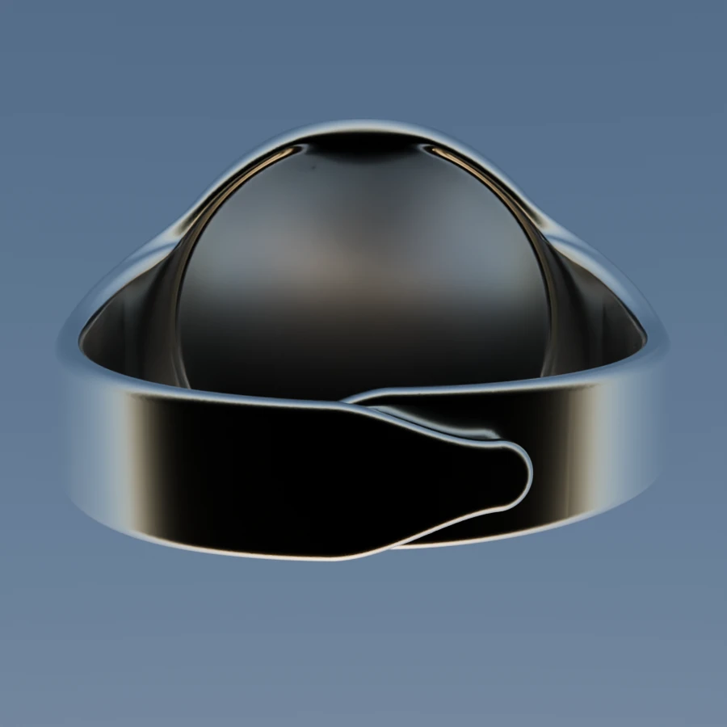
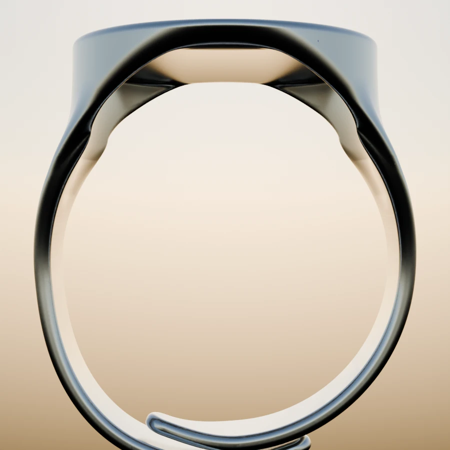
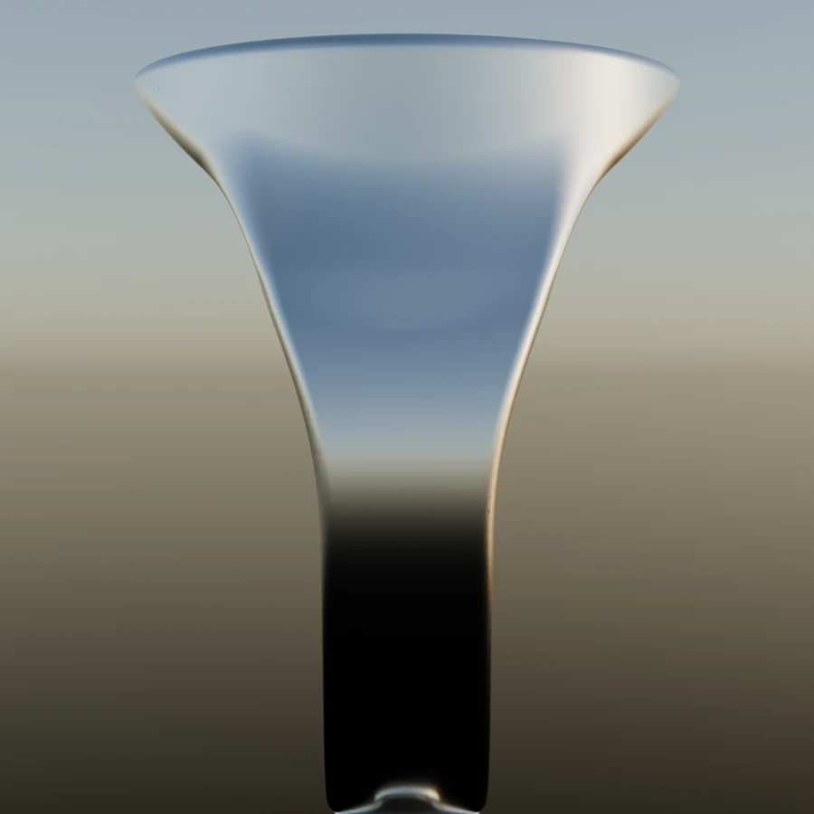
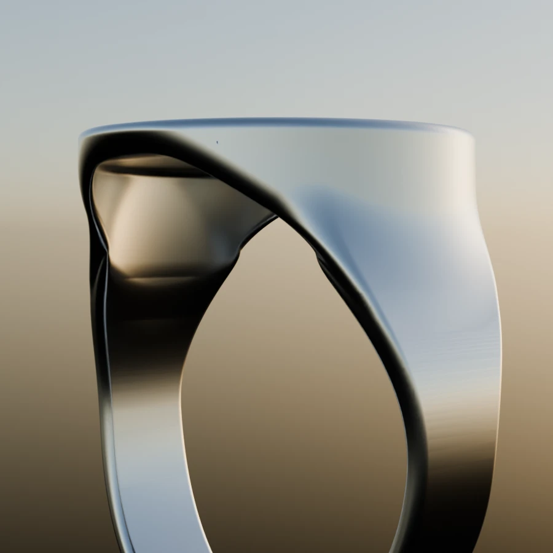

# khatm-ring

A sterling silver seal ring (khatm), modelled for casting. The round face carries the prophetic seal inscription, top to bottom, الله / رسول / محمد. The band is open. Its ends overlap under the finger, and you size the ring by bending them.



| Face | Three-quarter | Underside |
|---|---|---|
|  |  |  |
| **Front** | **Side** | **Low three-quarter** |
|  |  |  |

## Files

| Path | Contents |
|---|---|
| `model/khatm-ring.stl.xz` | The ring for casting, as one closed binary STL in millimetres, xz-compressed |
| `model/renders/` | Cycles renders and the contact sheet above |
| `site/` | The 3D viewer |

Unpack the STL with `xz -dk model/khatm-ring.stl.xz` or 7-Zip, or use the STL button in the viewer.

Its per-facet normals are zero. The order of each facet's corners already gives the facet's direction, and slicers and casting services recompute the normals from it. The 80-byte header names the [`build`](../../tree/build) commit the file came from, with the ring's weight and size.

The model is built on the [`build`](../../tree/build) branch, from the seal references, the traced inscription and the design parameters.

## Weight

The ring is sized to **5.80 g in sterling silver**, under the Maliki limit for a man's silver ring of two shar'i dirhams.

| Step | Value | Note |
|---|---|---|
| 1 shar'i dirham | 2.975 g | some put it at 3.0 g |
| Limit, 2 dirhams | 5.95 g | |
| Target | 5.80 g | leaves room if the dirham is 3.0 g, and for alloy density |
| Sterling 925 density | 10.36 g/cm³ | fine silver is about 10.49 |

The weight comes from the model's volume, not from a casting. Sprue position, porosity and polishing all move it, so weigh the real ring.

## Casting

- Sections stay between about 0.6 mm (the centre of the face plate) and 1.3 mm.
- Letter features are at least 0.4 mm wide, and counters at least 0.6 mm.
- Every outside edge is rounded, and the arms blend into the head.
- The band ends overlap with a 0.35 mm gap, so they don't fuse in the mould.
- The mesh is one closed shell with no non-manifold edges.

## Viewer

`site/` is a TypeScript three.js page built with bun. The ring floats 10 mm above rippled sand, lit by six warm softboxes and two more above and below it. The page unpacks the STL in the browser. It darkens every upward facet at the `field_z` height in the STL's header, which is the recessed field, and links the build commit under the title.

Bun names the JS and CSS after a hash of their content, and `build.ts` does the same for the model (`khatm-ring.<hash>.stl.xz`). Only `index.html` keeps its name, so browsers keep the rest cached until it changes.

```sh
cd site
bun install
bun run dev     # serves the page and ../model/khatm-ring.stl.xz
bun run check   # tsc, oxlint (type-aware), oxfmt
bun run build   # writes dist/
```

Hooks in `.pre-commit-config.yaml` run the same checks before each commit: `uvx prek install` (or `pre-commit install`).
