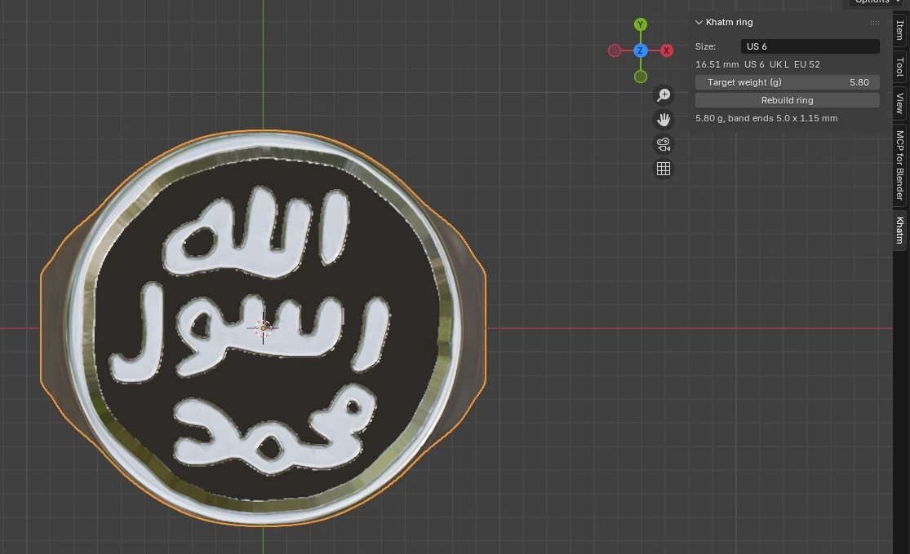

# khatm-ring: build

This branch holds what the khatm ring is made from. It has the seal references, the traced inscription, the design parameters, and the `khatm` command that turns them into a mesh for casting. The finished ring, with its STL, renders and 3D viewer, is on [`main`](../../tree/main).

## Set up

```sh
uv sync                          # installs the khatm command and its locked dependencies
git worktree add out main        # where builds are published
uvx prek install                 # ruff, ty and the lock check before each commit
```

The build needs Blender 4.5 LTS. Put `blender` on `PATH`, or set `BLENDER` to its executable.

## Commands

| Command | Does |
|---|---|
| `khatm size "UK R1/2"` | Converts a ring size to inside diameter, US, UK and EU |
| `khatm inscription [variant]` | Traces the seal and lays the letters out on the face |
| `khatm build [--render]` | Runs Blender headless: meshes the ring, dresses it, exports, then publishes to `out/` |
| `khatm publish` | Compresses the cached STL and renders into `out/model/` |
| `khatm sdf [--size …] [--target-g …]` | Meshes the distance field alone, for trying constants |
| `khatm sdf --sample in.f32 --sample-out out.f32` | Writes the field at given points, for checking the viewer's GPU port |
| `khatm live-build` | Rebuilds in a live Blender and adds the Khatm sidebar tab |
| `khatm live file.py` or `-c CODE` | Runs a snippet in a live Blender; it can `import khatm` |

Run them as `uv run khatm …`, or bare inside the activated `.venv`. The live commands need the [BlenderMCP](https://github.com/ahujasid/blender-mcp) add-on running in an open Blender (start Blender with `--addons addon`).

## Layout

| Path | Contents |
|---|---|
| `design/ring.toml` | Ring size and target weight, the model's driving parameters |
| `design/inscription-layout.json` | Position, turn, scale, weight and source of each letter piece |
| `reference/seal/` | Public-domain renderings of the seal the letters are traced from, with `SOURCES.md` |
| `reference/extracted/` | The ring cut out of each photo of the original, and the laid-out inscription |
| `src/khatm/` | The `khatm` package: sizes, inscription, distance field, publishing |
| `src/khatm/blender/` | Scripts that run inside Blender's own Python |
| `cache/` | Ignored. The raw mesh, the uncompressed STL, the .blend, stats and PNG renders |
| `out/` | Ignored. A worktree of `main` that `khatm publish` writes into |

The scripts are the source of truth. The .blend is rebuilt each time and never committed.

## Parameters

`design/ring.toml` holds the two values that drive the model, like a SOLIDWORKS design table.

| Key | Example | Effect |
|---|---|---|
| `size` | `"US 9"`, `"UK R1/2"`, `"EU 59"`, `"19 mm"` | Inside diameter. `ring_sdf.py` measures every height on the ring from the finger |
| `target_g` | `5.8` | Grams of sterling. The solver sizes the band ends to meet it |

Edit the file and run `khatm build`. Or, in a live Blender, open the Khatm tab in the 3D view's sidebar (N):



It shows the size on each scale as you type. **Rebuild ring** saves both values to the file, rebuilds the ring in the open window and publishes it to `out/`, which takes about a minute. `khatm sdf --size "UK P" --target-g 5.5` overrides the file for one run without saving.

The size scales in `ring_size.py` follow jewellers' charts. Check a real size against a ring sizer before casting.

## Inscription

`inscription.py` traces the letters from a seal rendering in `reference/seal/` rather than redrawing them, so they keep their thick and thin strokes and tapered ends. It then thickens them to the stroke weight of the original ring and rounds off any tip too fine to cast.

Each connected letter group is a piece: `allah_1`, `allah_2`, `rasul_1` to `rasul_3` and `muhammad_1`, numbered right to left within each line. See `reference/extracted/inscription-labelled.png`.

To rebalance the pieces, either:

- edit `design/inscription-layout.json` (`dx` and `dy` in mm, `rotate` in degrees, `scale`, `bold` in mm), or
- drag them in a live Blender. `khatm live -c "from khatm.blender import live_letters; live_letters.show()"` lays them over the face. Move them in top view, then run the same command with `read_back()` in place of `show()`.

Then run `khatm inscription` and rebuild. It warns when two pieces come within 0.35 mm of each other or of the rim.

`inscription.py` can trace three renderings, `canonical`, `impression` (the most hand-cut) and `asymmetric`. The default, `mixed`, takes each piece from the rendering that its `from` key names in the layout's `mixed` entry.

| Piece | From | Why |
|---|---|---|
| `allah_1`, `allah_2` | `impression` | The heavy, hand-cut الله |
| `rasul_1` to `rasul_3` | `asymmetric` | A curved ر, a hooked ل and a و with a tail |
| `muhammad_1` | `asymmetric` | Two even, round meems and a clear ح |

`bold` thickens a piece's strokes, so the thinner `asymmetric` letters match the weight of الله. `khatm inscription asymmetric` uses one rendering throughout, and `reference/extracted/inscription-variants.jpg` compares all four with the original ring.

## Form

`ring_sdf.py` models the whole ring as one signed distance field and meshes it once with marching cubes. It joins the parts with smooth unions, so every join is a fillet without any later smoothing.

- **Head.** There is no ledge under the face. Across the finger, the wall drops from the crown round and leans out a little (`HEAD_FLARE`) until it runs into the band. Along the finger, the underside follows the band's curve and rises to the face edge, so from the side the head is a boat that narrows into the band. The back is open, with a rolled lip and a domed ceiling, and the hollow's wall meets the finger hole along its tangent. On a finger narrower than the head, about US 7 and below, that wall curves inward first (`CAVITY_TUCK`, `CAVITY_TUCK_Z`). There the band has also narrowed by the time it meets the head, so past `HEAD_SIDE_START_DEG` the head's sides come in to the band's width, and the shoulder runs down into the band instead of hanging past it. Below about US 5 the band's outside sits inside the head's widest wall, so the wall tucks in to meet the band at `HEAD_TUCK_Z` and sinks into it (`HEAD_TUCK`, `HEAD_BURY`).
- **Band.** It flares to 8.5 mm wide and 1.3 mm thick under the head, along one eased curve for width and thickness. It then thins to rounded tips 0.9 mm thick, which you bend to size. A faint width wave keeps it from looking machined.
- **Joins.** The shoulders blend into the head with a 1.5 mm fillet (`K_SHOULDER`), which fades out round the finger from where the head's wall meets the band. The fillet fades to nothing before the overlap, so the two ends never fuse (`OVERLAP_GAP`).
- **Face.** The rim's outer edge is a true circle. Its inner edge follows the hand-cut border of the seal reference, and a 45° bevel leads down into the oxidised field.

The dimensions are estimates from the photos. Change them with the constants at the top of `ring_sdf.py`.

## Weight

The solver weighs the ring at sterling's density, `DENSITY_G_MM3`. `main`'s README explains the two-dirham limit behind 5.8 g. `khatm sdf --solve`, which the build runs, keeps the head and shoulders' shape:

1. It widens or narrows the band's ends within `BAND_W_END_RANGE`.
2. If the ends are as wide as they go and the ring is still light, as on small sizes, it thickens the plate under the face within `PLATE_EXTRA_RANGE`, so the extra metal sits under the crown and the band stays slim. US 4 takes 0.25 mm.
3. If the ends are as narrow as they go and the ring is still heavy, it thins them within `BAND_T_END_RANGE`.

It counts metal on a 0.1 mm grid in seconds, then meshes at 0.05 mm. The build warns if the ring misses the target, which leaves it lighter, never heavier.

## Publishing

`khatm build` and the panel's **Rebuild ring** both end with `khatm publish`, which writes two things into the `main` worktree at `out/`.

- `model/khatm-ring.stl.xz` is the STL, xz-compressed. Its per-facet normals are zeroed, which shrinks the file from 6.2 MB to 2.45 MB. Its 80-byte header holds `key=value` pairs the viewer reads: `build`, `field_z`, `grams`, `inside_d`, `us` and `uk`. `build` is this branch's short commit hash, with a `+` if the tree had uncommitted changes.
- `model/renders/*.webp` are the renders, if the build made them, and `contact-sheet.webp` puts them beside two of the reference photos.
- `model/ring-sdf.json` and `model/face-fields.f16.xz` are what the viewer needs to rebuild the ring at other sizes. The JSON holds `ring_sdf.py`'s constants, the size scales and the target weight. The xz file holds the two face rasters, the field outline and the letters, as float16.

Commit on this branch first, so the `build` stamp names a real commit. Then review and commit the new files in `out/`.

The viewer on `main` has its own copy of the field's code, in WGSL. Its CI checks that copy against `ring_sdf.py` at the commit the STL's `build` stamp names, so a change to the field's code here needs the same change there.
